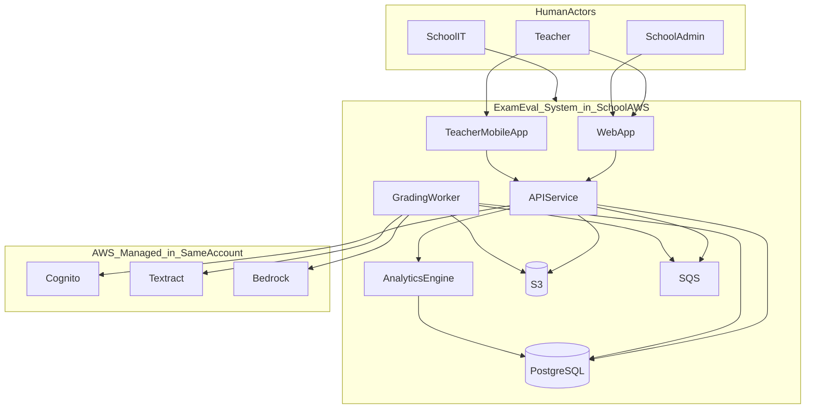
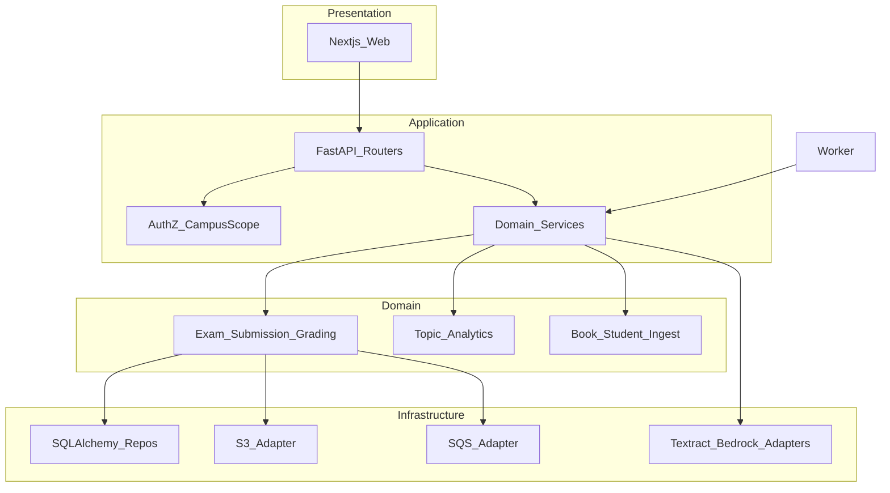
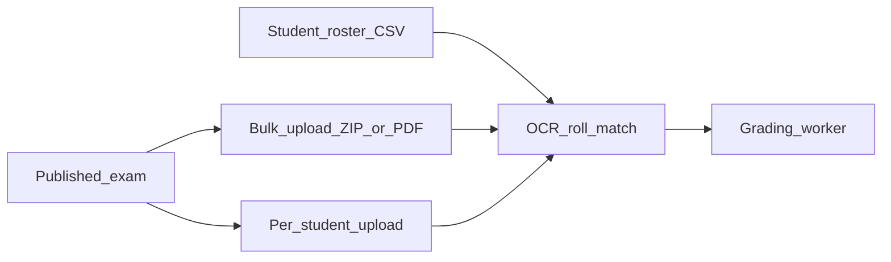
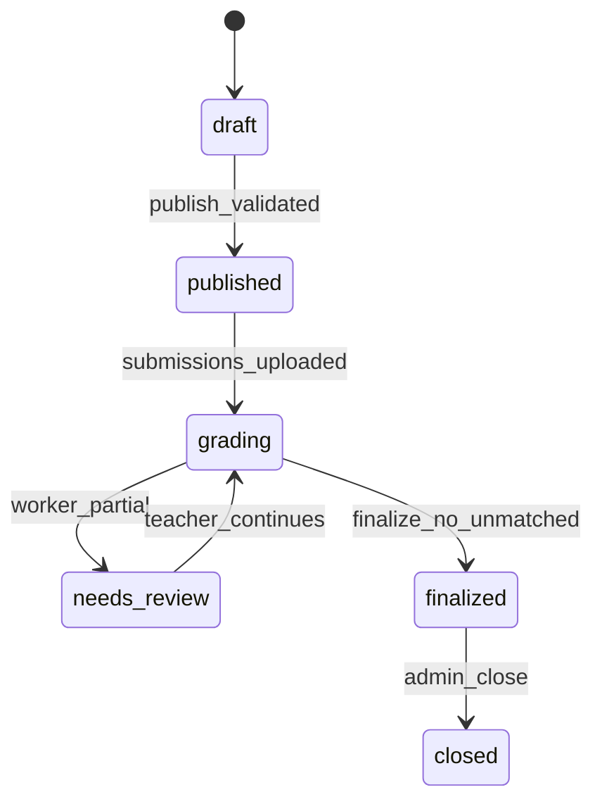

# Exam-Eval — High-Level & Low-Level Design

**Version:** 1.0  
**Date:** 13 October 2026  
**Companion:** [Exam-Eval-Product-Development-Plan.md](./Exam-Eval-Product-Development-Plan.md)

---

## Part 1 — High-Level Product Design (HLD)

### 1.1 Purpose

Exam-Eval is installed in a **school’s AWS account**. It ingests rosters, textbooks, answer keys, and scanned sheets; grades mixed exams with AI assistance; stores marks; and produces **topic-level insights** for teaching. This HLD defines **logical components**, **trust boundaries**, and **interaction patterns**. Part 2 gives **LLD per component**.

### 1.2 Context diagram



**External (out of v1):** vendor license API (metadata only), optional MSP support via temporary IAM role.

### 1.3 Component catalog (logical)

| ID | Component | Responsibility |
|----|-----------|----------------|
| C1 | **Web App** | Staff UI: roster, exams, **bulk** upload, review, insights, admin |
| C1b | **Teacher Mobile App** | Per-student camera/gallery upload, roster pick, upload status |
| C2 | **API Service** | REST, authZ, validation, orchestration, presigned URLs |
| C3 | **Grading Worker** | Async OCR, scoring, enqueue side-effects |
| C4 | **Analytics Engine** | Topic rollups on finalize; term queries (library in API + batch job) |
| C5 | **PostgreSQL** | System of record; RLS for campus isolation |
| C6 | **S3** | Scans, books, keys, exports |
| C7 | **SQS** | Grading and analytics job queues |
| C8 | **Cognito** | Authentication; groups for campus/role |
| C9 | **Textract / Bedrock** | OCR and LLM grading (school account) |
| C10 | **Install CLI / IaC** | Provision ECS, RDS, S3, etc. (not runtime app logic) |

### 1.4 Layered architecture



### 1.5 Primary runtime flows

#### Flow A — Publish exam

1. Teacher completes exam wizard (questions, key, topic tags, sheet template).
2. API validates campus scope and topic coverage.
3. API persists `exams` + `exam_questions` + `answer_keys`; status → `published`.

#### Flow B — Grade submission batch

**Prerequisite:** Student **roster** exists for campus + class/section tied to the exam.

1. Teacher uploads scans (**bulk** default, or **per-student** with `student_id`).
2. API stores metadata, presigned S3 URLs (or multipart).
3. API creates `submissions` + `jobs`; messages to **grading queue**.
4. Worker: split pages (bulk) → OCR roll no → match roster student → grade → `grading_results`.
5. Unmatched → manual match UI; optional add student to roster.
6. Low confidence → `needs_review`; teacher overrides via API.
7. Teacher **finalizes** → analytics job.



#### Flow C — Class insights

1. Analytics job computes `exam_topic_stats` + `class_topic_summary`.
2. Teacher opens Class Insights UI → API reads materialized tables (no LLM required).

### 1.6 Deployment unit (physical mapping)

| Logical | Physical (school AWS) |
|---------|------------------------|
| C1 Web | ECS service `exam-eval-web` |
| C2 API | ECS service `exam-eval-api` |
| C3 Worker | ECS service `exam-eval-worker` (autoscale on SQS) |
| C4 Analytics | Same worker image, different queue handler **or** API inline for small schools |
| C5 DB | RDS PostgreSQL Multi-AZ (prod) |
| C6 S3 | Bucket `exam-eval-{env}-data` with KMS |
| C7 SQS | `grading.fifo` or standard + `analytics` + DLQs |
| C8 Cognito | User pool + app client for web |
| C10 | Terraform + `exam-eval` CLI (install time only) |

### 1.7 Cross-cutting concerns

| Concern | Approach |
|---------|----------|
| **Tenancy** | `campus_id` on rows; JWT carries allowed campuses; RLS in Postgres |
| **Idempotency** | Job messages include `submission_id` + `attempt`; workers skip if already `final` |
| **Observability** | Structured JSON logs; correlation id `request_id` / `job_id`; no answer text in logs |
| **Errors** | DLQ + admin alert; UI shows job failure reason (sanitized) |
| **Versioning** | API `/api/v1`; DB migrations via Alembic |

### 1.8 Interface summary between components

| From | To | Protocol | Payload |
|------|-----|----------|---------|
| Web | API | HTTPS JSON | REST + JWT |
| API | Postgres | SQL/TCP | Parameterized queries + `SET LOCAL` for RLS |
| API | S3 | HTTPS | Presigned PUT/GET |
| API | SQS | AWS API | JSON job envelope |
| Worker | SQS | Long poll | Same envelope |
| Worker | Textract/Bedrock | AWS API | Bytes / prompts |
| Web | Cognito | OAuth2/OIDC | Hosted UI or embedded |

---

## Part 2 — Low-Level Design (LLD) by Component

---

### C1 — Web App (Next.js)

#### Responsibilities

- Authenticated SPA/SSR for teachers and admins.
- **Bulk** file upload (ZIP/PDF; presigned S3).
- Roster import and **student profile** (class, section, roll no, marks history, topic insights).
- Real-time job progress (polling or SSE).
- Review UI (image crops + score editor).
- Insights charts (class heatmap, student table).

**Not primary on web:** walking class with phone camera — see **C1b Mobile**.

---

### C1b — Teacher Mobile App (Expo / React Native)

#### Responsibilities

- Cognito login (PKCE); campus context.
- Select **published exam** → **class/section** → student list from roster DB.
- **Per-student upload:** device camera or gallery → compress → presigned PUT → `complete` API.
- Show per-student status: not uploaded / processing / graded / needs review.
- Optional: display latest **total marks** for that exam (read-only); full review stays on web (v1).

#### Module structure

```
apps/mobile/
├── app/                 # Expo Router screens
│   ├── (auth)/
│   ├── exams/
│   ├── classes/[id]/students/
│   └── upload/[studentId].tsx
├── components/
│   └── CameraCapture.tsx
└── lib/
    ├── api-client.ts    # from packages/api-client
    └── auth.ts
```

#### LLD: per-student upload flow

1. `GET /exams/{id}/roster?section=` → list students with `submission_status`.
2. Teacher taps student → `POST /exams/{id}/submissions/students/{student_id}/presign`.
3. App PUT image(s) to S3 (background upload + retry).
4. `POST .../complete` → enqueue grading job.
5. Poll `GET /submissions/{id}` until `graded` or error.

**Offline (future):** queue captures locally; sync when online — not v1.

#### Platform

- iOS + Android via Expo; same API base URL as web (school domain).

#### Module structure

```
apps/web/
├── app/                    # App Router pages
│   ├── (auth)/login/
│   ├── dashboard/
│   ├── students/
│   ├── subjects/[id]/topics/
│   ├── textbooks/
│   ├── exams/[id]/
│   │   ├── wizard/
│   │   ├── upload/
│   │   ├── review/
│   │   ├── marks/
│   │   └── insights/
│   └── settings/
├── components/
│   ├── ui/                 # shadcn
│   ├── upload/
│   ├── review/
│   └── insights/
├── lib/
│   ├── api-client.ts       # typed fetch wrapper
│   ├── auth.ts             # Cognito session
│   └── campus-context.tsx  # selected campus
└── types/                  # shared DTOs
```

#### Key design decisions

| Topic | Decision |
|-------|----------|
| Auth | Cognito Hosted UI or Amplify; store tokens in memory + httpOnly refresh cookie pattern |
| Campus | Header switcher sets `X-Campus-Id` on API calls (must match JWT allowance) |
| Upload | Client requests `POST /uploads/presign` → PUT to S3 → `POST /submissions/complete` |
| Review | Load signed GET URLs for crops; debounce PATCH on score change |
| State | React Query for server state; wizard uses local state + draft save API |

#### API coupling (representative)

- All calls: `Authorization: Bearer`, `X-Campus-Id`, `X-Request-Id` (optional).
- Error model: `{ "code", "message", "details" }`.

#### Upload UX (teacher)

| Screen | Behavior |
|--------|----------|
| **Bulk upload** | Drag ZIP/PDF/images; show progress; list detected sheets vs roster (matched / unmatched / duplicate). |
| **Per-student** | Search student by name/roll → attach file(s) → immediate queue for that `submission_id`. |
| **Manual match** | For bulk orphans: pick student from class roster or create student (if permitted). |

---

### C2 — API Service (FastAPI)

#### Responsibilities

- JWT validation (Cognito JWKS).
- Campus authorization middleware.
- CRUD + workflow transitions (exam publish, finalize).
- Presigned URL issuance (scoped prefix).
- Enqueue SQS messages.
- Trigger analytics (sync for dev, async prod).

#### Process architecture

```
apps/api/
├── main.py
├── core/
│   ├── config.py           # Settings from env/SSM
│   ├── security.py         # JWT, campus checks
│   ├── db.py               # Session + SET LOCAL campus
│   └── logging.py
├── api/v1/
│   ├── routers/            # thin controllers
│   └── deps.py             # CurrentUser, CampusId
├── domain/
│   ├── exams/
│   ├── submissions/
│   ├── grading/
│   ├── insights/
│   └── ingest/
├── infrastructure/
│   ├── repositories/
│   ├── s3.py
│   └── sqs.py
└── migrations/             # Alembic
```

#### Request lifecycle

1. `CORSMiddleware` → `RequestIdMiddleware`.
2. `AuthMiddleware`: parse JWT → `UserContext(user_id, roles, campus_ids[])`.
3. `CampusMiddleware`: read `X-Campus-Id` → verify ⊆ `campus_ids` → `SET LOCAL app.campus_id`.
4. Router → service → repository (RLS enforced).
5. `commit` or `rollback`; return DTO.

#### Exam state machine



**Guards on finalize:**

- No `submissions` in `unmatched`.
- Config: zero `grading_results` in `pending_review` (optional strict).

#### Submission upload endpoints

| Endpoint | Use |
|----------|-----|
| `POST /exams/{id}/submissions/bulk` | Start bulk session; returns `upload_session_id` + presign batch |
| `POST /exams/{id}/submissions/bulk/complete` | Close session → enqueue split/match jobs |
| `POST /exams/{id}/submissions/students/{student_id}` | Per-student upload (presign + complete) |

Bulk path creates `submissions` with `student_id=NULL` until worker matches; per-student path sets `student_id` immediately.

#### Presigned URL policy

- Key pattern: `campuses/{campus_id}/exams/{exam_id}/submissions/{uuid}/{filename}`.
- Max size 50 MB/file (configurable); content-type whitelist `image/*`, `application/pdf`.
- TTL 15 minutes.

#### SQS message envelope

```json
{
  "type": "grade_submission",
  "version": 1,
  "submission_id": "uuid",
  "exam_id": "uuid",
  "campus_id": "uuid",
  "requested_at": "ISO8601"
}
```

```json
{
  "type": "compute_exam_insights",
  "version": 1,
  "exam_id": "uuid",
  "campus_id": "uuid"
}
```

---

### C3 — Grading Worker

#### Responsibilities

- Consume `grade_submission` messages.
- Run pipeline: identity → layout → MCQ / handwritten branches.
- Write `submission_answers`, `grading_results`.
- Update `submissions.status`.

#### Worker layout

```
workers/grader/   # or apps/api/worker_main.py
├── consumer.py           # SQS loop, graceful shutdown
├── pipeline/
│   ├── identity.py       # roll OCR + roster match
│   ├── layout.py         # template JSON apply
│   ├── mcq.py
│   ├── handwritten.py
│   └── aggregate.py
├── adapters/
│   ├── textract.py
│   └── bedrock.py
└── handlers/
    ├── grade_submission.py
    └── compute_insights.py
```

#### `grade_submission` algorithm (LLD)

```
INPUT: submission_id
LOAD submission, exam, template, questions, keys, student (if matched)

IF pages not split:
  split_pdf_to_pages → S3 + submission_pages

IF student_id IS NULL:
  crop roll_region → Textract → normalize_roll_no
  MATCH students WHERE campus, class, roll_no
  IF 0 matches → status=unmatched; RETURN
  IF >1 matches → status=ambiguous; RETURN
  ELSE set student_id

FOR each question in exam_questions ORDER BY q_no:
  crop region from template
  IF type == mcq:
    score = mcq_score(crop, key.correct_option)
    confidence = high
  ELSE:
    text = textract(crop)
    IF exam.use_rag: chunks = vector_search(question, textbook)
    result = bedrock_grade(prompt, schema=GradingResult)
    score = result.score; confidence = result.confidence

  UPSERT submission_answers, grading_results

SET submission.status = needs_review IF any confidence < threshold ELSE graded
```

#### Bedrock contract

**Input:** question text, max_marks, rubric, model_answer, ocr_text, language, optional rag_snippets.

**Output JSON schema:**

```json
{
  "score": 0,
  "max_marks": 5,
  "confidence": 0.85,
  "rationale": "string",
  "missing_points": ["string"]
}
```

**Model:** Claude on Bedrock (config per env); temperature 0.1; max tokens capped.

#### Concurrency & scaling

- ECS desired count = `ceil(queue_depth / target_messages_per_task)`.
- One message per submission (not per page) for v1.
- Visibility timeout ≥ p99 grading duration (e.g. 15 min).

---

### C4 — Analytics Engine

#### Responsibilities

- On finalize (or dedicated message): recompute topic aggregates.
- Serve read models for insights APIs.

#### Computation (per exam)

For each `(student_id, topic_id)`:

```
marks_obtained = SUM(gr.final_score) for questions tagged topic
max_marks = SUM(q.max_marks) for questions tagged topic
pct = marks_obtained / max_marks * 100
```

For each `topic_id` in exam:

```
weak_students = COUNT students WHERE pct < threshold OR pct in bottom_quartile(class)
class_median = MEDIAN(pct)
```

**Tables:**

- `exam_topic_stats(exam_id, student_id, topic_id, pct, marks_obtained, max_marks)`
- `class_topic_summary(exam_id, topic_id, section, weak_count, student_count, median_pct)`

#### Term rollup

- Query exams WHERE subject_id, class, campus, `finalized_at` in range.
- Weighted average of `pct` across exams (weight = max_marks per topic in each exam).

#### Invalidation

- On `PATCH grading_results`: enqueue recompute for that exam (debounced 30s).

---

### C5 — PostgreSQL + RLS

#### Connection pattern

- API pool: `pool_size=20`, `pre_ping=True`.
- After checkout: `SET LOCAL app.current_user_id = ...`; for single-campus request `SET LOCAL app.campus_id = ...`.
- RLS policy: `campus_id = current_setting('app.campus_id', true)::uuid`.

#### Index strategy (critical)

| Table | Index |
|-------|--------|
| students | `(campus_id, class, roll_no)` UNIQUE |
| submissions | `(exam_id, status)`, `(student_id)` |
| grading_results | `(submission_id, question_id)` |
| exam_topic_stats | `(exam_id, topic_id)` |
| textbook_chunks | pgvector HNSW on `embedding` + `(textbook_id)` |

#### Migration policy

- Alembic forward-only in prod; reversible scripts in dev.
- RLS enabled in migration `xxxx_enable_rls.sql`.

---

### C6 — S3 Object Store

#### Bucket layout

```
campuses/{campus_id}/
  textbooks/{textbook_id}/source.pdf
  textbooks/{textbook_id}/chunks/...
  exams/{exam_id}/
    template.json
    keys/import.csv
    submissions/{submission_id}/
      original.pdf
      pages/001.png
      crops/q01.png
  exports/{exam_id}/marks.csv
```

#### Lifecycle

- Optional rule: delete `submissions/*/pages/` after N days; keep aggregates in DB.

#### KMS

- SSE-KMS CMK; bucket policy denies unencrypted put.

---

### C7 — SQS Queues

| Queue | Producer | Consumer | DLQ |
|-------|----------|----------|-----|
| `exam-eval-grading` | API | Worker | `exam-eval-grading-dlq` |
| `exam-eval-analytics` | API | Worker | `exam-eval-analytics-dlq` |

- Message retention 14 days; maxReceiveCount 3.
- CloudWatch alarm on DLQ depth > 0.

---

### C8 — Cognito

#### User pool

- Attributes: `email`, `custom:campus_ids` (comma-separated UUIDs) or group-per-campus.
- Groups: `school_admin`, `teacher`, `viewer` mapped to app roles.

#### App client

- OAuth: Authorization code + PKCE for web.
- Token use: API validates `aud`, `iss`, `exp`; map `sub` → `users.cognito_sub`.

#### First admin

- Created in post-install wizard or CLI `exam-eval install --admin-email`.

---

### C9 — Textract & Bedrock Adapters

#### Textract

- `AnalyzeDocument` with `FeatureTypes=['FORMS']` for OMR regions; handwriting as LINE blocks.
- Retry with exponential backoff on throttling.
- Store raw blocks in S3 optional (`debug/`) only if `DEBUG_OCR=true`.

#### Bedrock

- `InvokeModel` with guardrails (future).
- Rate limit: worker semaphore per account (configurable TPS).
- Fallback: mark `needs_review` if Bedrock fails after retries.

---

### C10 — Install CLI & IaC

#### CLI commands (LLD)

| Command | Actions |
|---------|---------|
| `doctor` | STS identity, region, Bedrock model access, S3 backend bucket exists |
| `install` | Prompt params → write tfvars → terraform init/apply → mirror images → smoke `GET /health` |
| `upgrade` | Pull new images → terraform apply image tags → run Alembic job task |
| `status` | Print stack outputs URL, RDS endpoint (masked), last deploy version |

#### Terraform modules

```
infra/terraform/school-install/
├── main.tf
├── variables.tf
├── outputs.tf
├── modules/
│   ├── network/
│   ├── rds/
│   ├── s3_kms/
│   ├── ecs_services/
│   ├── cognito/
│   ├── sqs/
│   └── observability/
```

**Outputs:** `alb_dns`, `user_pool_id`, `app_client_id`, `bucket_name`, `ecr_repo_urls`.

---

## Part 3 — Component interaction matrix

|  | Web | Mobile | API | Worker | DB | S3 | SQS | Cognito | Textract | Bedrock |
|--|:---:|:------:|:---:|:------:|:--:|:--:|:---:|:-------:|:--------:|:-------:|
| Web | - | - | R | - | - | W | - | R | - | - |
| Mobile | - | - | R | - | - | W | - | R | - | - |
| API | - | - | - | RW | RW | W | R | - | - |
| Worker | - | - | - | RW | R | R | - | R | R |

R = read/call, W = write/upload, RW = both.

---

## Part 4 — Security LLD (summary)

| Threat | Control |
|--------|---------|
| Cross-campus data leak | RLS + middleware campus check |
| Token theft | Short access token; HTTPS only |
| S3 URL sharing | Short TTL presigned; campus in key path |
| Prompt injection in OCR text | Sanitize length; structured output only |
| Privilege escalation | Admin routes require `school_admin` role |

---

## Part 5 — Observability LLD

| Signal | Where |
|--------|--------|
| Request logs | API: method, path, status, duration, user_id, campus_id |
| Job logs | Worker: job type, submission_id, stage, duration |
| Metrics | CloudWatch: `GradingJobSuccess`, `GradingJobDuration`, `BedrockErrors` |
| Traces | Optional X-Ray on API/worker (Phase 4) |

---

## Document control

| Version | Date | Notes |
|---------|------|-------|
| 1.0 | 2026-10-13 | Initial HLD + per-component LLD |

---

*End of document*
